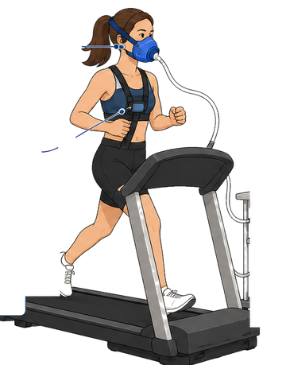

# HPC CPET report builder

Single-file web app (React + Babel in the browser, PDF.js for PDF import) that turns an existing
cardiopulmonary exercise test (CPET) report PDF, or a raw breath-by-breath data sheet (.xlsx),
into a client-friendly report. Clinical and Performance report types.

- `index.html` is the runnable app; open it in a browser.
- `src/page.html` is the editable source (images are `__BLOB_n__` placeholders held in `src/blobs.json`).
- `python3 build.py` regenerates `index.html` from the source.
- `data/vo2max-norms.json` holds the VO2max percentile tables (treadmill and cycle, male and female, ages 20-89) used for the percentile and category.

Privacy: no client data is stored in this repo. The sample client is a made-up placeholder.
Imported files are read in the browser only.
